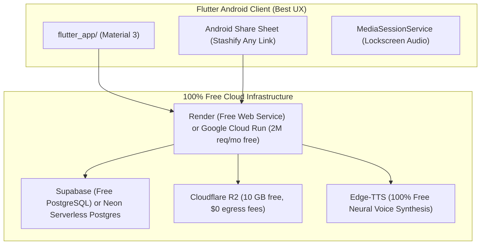

# Microstash — The Mental Model Gym 🧠

> **"Stop hoarding ideas. Start wiring high-leverage frameworks into your brain."**

Microstash is an active microlearning and cognitive training engine built to replace passive book-saving with **active recall**, **interactive systems flowcharts**, and **Socratic AI decision dilemmas**.

---

## ⚡ The Moat: Why Microstash vs. Deepstash?

| Dimension | Deepstash (Passive Hoarding) | Microstash (Active Retention) |
| :--- | :--- | :--- |
| **Philosophy** | "Replace doomscrolling with microlearning" (passive bookmarking) | **"The Mental Model Gym"** — Wire decision frameworks into long-term memory |
| **Learning Engine** | Static card feed (forgotten within 48h) | **Leitner Spaced Repetition (Boxes 1–5)** with daily memory workouts |
| **Interactive AI** | Read-only summaries | **Socratic "Stress-Test Me"**: AI tests you with high-stakes decision dilemmas |
| **Visual Architecture** | Static stock photos / quotes | **Interactive Mermaid.js & SVG Systems Diagrams** with zoom & pan |
| **Instant Ingestion** | Closed manual curation | **"Stashify Any Link"**: 1-click web extraction & first-principles decomposition |
| **Audio Synthesis** | Robotic / paywalled TTS | **Neural Edge-TTS** 45-second micro-podcasts with lockscreen background controls |

---

## 📱 Google Play Production Architecture (Best & 100% Free Tier)



### Free Tier Cloud Setup:
- **Backend**: Containerized via [`Dockerfile`](Dockerfile) ready for **Google Cloud Run** (2 million requests/month free forever) or **Render** ([`render.yaml`](render.yaml) 1-click deploy).
- **Database**: **Supabase** or **Neon** (PostgreSQL 500 MB free database tier; DDL defined in [`schema.sql`](schema.sql)).
- **Audio Storage**: **Cloudflare R2** (10 GB free S3-compatible storage with zero bandwidth fees).
- **Google Play Compliance**:
  - `POST /api/user/delete-account`: User data purge API required by Google Play Data Safety policy.
  - `GET /privacy`: Hosted public privacy policy.
  - `GET /terms`: Hosted terms of service.

---

## 🛠️ Local Development & Quick Start

### 1. Install Python Dependencies
```bash
cd C:\LLM\deepstash_microlearning
pip install -r requirements.txt
```

### 2. Launch the Application
```bash
python run.py
```
- App UI: **http://localhost:8000**
- API Docs: **http://localhost:8000/docs**
- Privacy Policy: **http://localhost:8000/privacy**

---

## 📱 Flutter Android Client (`flutter_app/`)

The mobile client is scaffolded under `flutter_app/`:
```bash
cd flutter_app
flutter pub get
flutter run
```

### Features included in Flutter client:
- **Tinder-style swipe deck** with gesture physics
- **Leitner Spaced Repetition workout screen** (`flutter_app/lib/screens/workout_screen.dart`)
- **Socratic Stress-Test dilemma screen** (`flutter_app/lib/screens/stress_test_screen.dart`)
- **Native Android Share target** (`android.intent.action.SEND`) in `AndroidManifest.xml`
- **Background audio permissions** (`FOREGROUND_SERVICE_MEDIA_PLAYBACK`)
